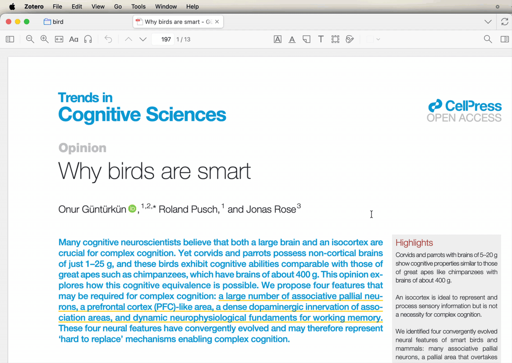
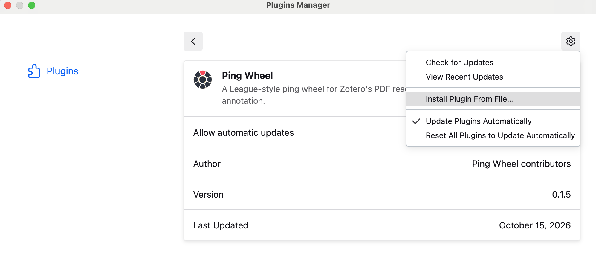
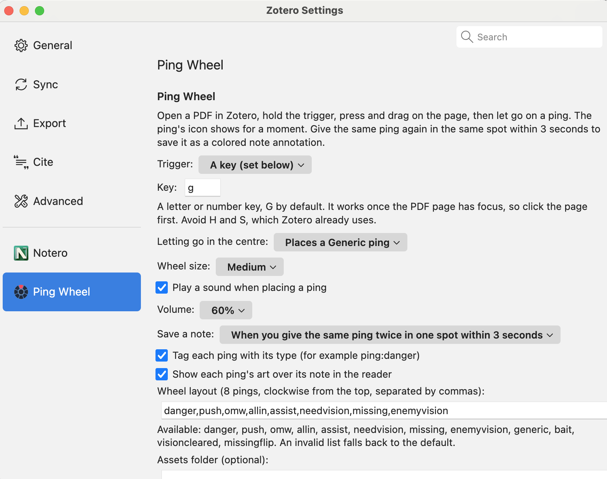

# Ping Wheel for Zotero

A League-style ping wheel for Zotero's PDF reader, inspired by [lolPing](https://github.com/darrenprx/lolPing). Ping a spot to flag it for a moment, or ping it twice to save the ping as a note annotation that shows in the annotation sidebar, syncs, and goes into the PDF when you export it.

## Install

1. Download the `.xpi` file from the [latest release](../../releases/latest).
2. In Zotero 7, 8 or 9: Tools → Plugins → gear icon → Install Plugin From File… → choose the file.

## Use

Open a PDF in Zotero's reader and click the page once. Hold **G**, press on the page, drag toward a ping and let go. The ping's icon pops up where you first pressed, with its sound, and fades after 3 seconds. Letting go in the centre gives a Generic ping, and **Esc** cancels.

To save a ping, give the same ping again in the same spot within 3 seconds. It's saved as a note annotation in the ping's color, with its name as the comment (for example "⚠️ Danger") and a tag such as `ping:danger`. Type in the comment later like any other note. To filter, click a tag at the bottom of the annotation sidebar.

In the reader, a saved ping shows as its art instead of Zotero's sticky-note icon. Click the art to open the note. The art is drawn by the plugin, not saved in the note, so exported PDFs, other PDF apps, and Zotero without this plugin show the usual sticky note.

To put the pings into the PDF file itself, right-click the PDF in your library → **Export PDF…** (or File → Save As… in the reader).

## Settings

Zotero Settings → Ping Wheel: the trigger (G by default, another key, or Alt, Shift, Ctrl or Command), the centre action, when to save a note (a double ping, or every ping), wheel size, sound and volume, tags, art on ping notes, the wheel layout, and an optional assets folder.

**Assets folder.** The plugin comes with lolPing's ping art and sounds. To use other copies of the same files, for example from a newer lolPing, download lolPing's source from [GitHub](https://github.com/darrenprx/lolPing) (Code → Download ZIP), unzip it, and paste the path of the unzipped folder into the assets folder setting. Any file the folder doesn't have comes from the plugin.

## Notes

- A key trigger works only while the PDF page has keyboard focus. If holding G does nothing, click the page first.
- Avoid H and S as the trigger key. Zotero uses them for its hand and select tools.
- With Alt as the trigger: on Linux, Alt + drag usually moves the window, and on Windows it may open Zotero's menu bar. Use a key or Shift instead.
- Works in PDFs only, not EPUBs or web snapshots.
- The plugin reaches into Zotero's reader internals to find the page under the mouse and to draw the art in place of the sticky note, so a future Zotero update may break it. If the reader's drawing changes, the art falls back to a dark circle that covers the sticky note. If nothing happens, check Help → Debug Output Logging for lines starting with "Ping Wheel".

## To do

- Holding G and dragging can select lines of text under the wheel. Zotero's PDF view registers its press handlers on the page before the plugin does, so it still starts a text selection, and its "pointer is down" state stays set after the ping, which may make it ignore the next click. If the page doesn't have keyboard focus, the plugin never sees G and the drag is a plain text selection. Possible fixes: also listen for G on Zotero's main window, which receives keys from the sidebar and toolbar, and clear Zotero's selection and pressed state when a ping ends.

## Credits

Ping Wheel is a Zotero port of [lolPing](https://github.com/darrenprx/lolPing) by Danrui Meng ([@darrenprx](https://github.com/darrenprx)). The wheel's look and slice geometry, and the ping list and colors, are adapted from lolPing's source under the MIT License. See `LICENSE` for the full notice.

The plugin was implemented with Claude Opus 5.5, Anthropic's AI model, in [Claude Code](https://claude.com/claude-code).

The ping art and sounds in `assets/` are © Riot Games, Inc. lolPing extracted them from League of Legends, and they are included here under Riot's [Legal Jibber Jabber](https://www.riotgames.com/en/legal) policy for free fan projects. They aren't covered by the MIT License.

Ping Wheel isn't endorsed by Riot Games and doesn't reflect the views or opinions of Riot Games or anyone officially involved in producing or managing Riot Games properties. Riot Games and all associated properties are trademarks or registered trademarks of Riot Games, Inc.
